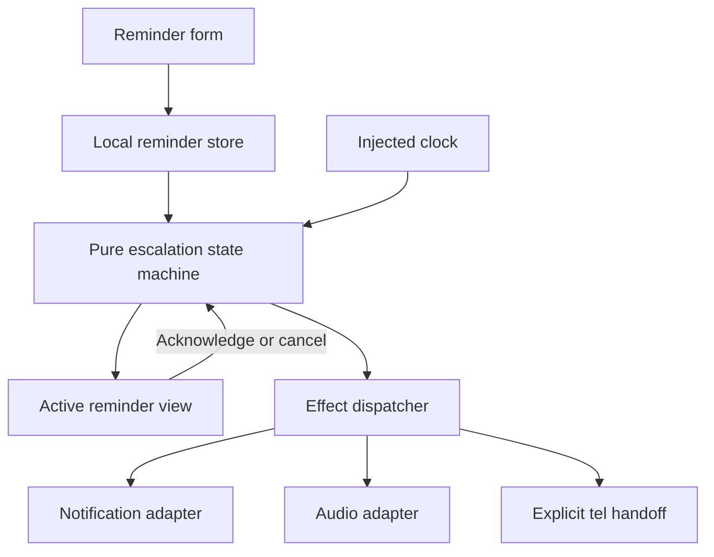
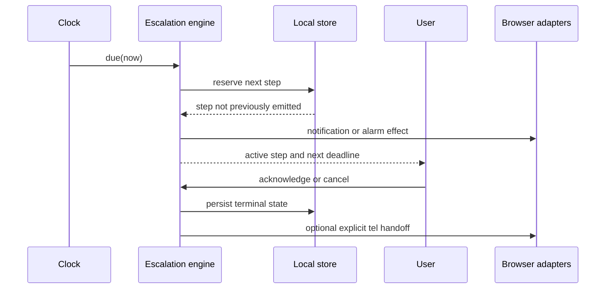

# UpNext Reliable Reminder Escalation Flow - Plan

## Goal Capsule

- **Objective:** An individual can create a scheduled reminder, stay on top of it through progressively stronger browser prompts, acknowledge it deliberately, and cancel safely before an emergency-contact handoff.
- **Means:** A local-first React/TypeScript web app with a deterministic escalation state machine, browser Notification/audio APIs, and a safe telephony adapter that records call intents and exposes `tel:` actions (KTD1, KTD2).
- **Authority:** The Product Contract below is the behavior authority; the Planning Contract resolves implementation choices only where the product contract is silent.
- **Stop conditions:** Do not claim delivery while the browser is closed, request emergency-contact escalation without explicit consent and a verified contact, or make the sequence user-configurable in this version.
- **Execution profile:** Build the complete first-build flow in this repository, with a simulator-friendly clock and tests that prove timing/state transitions without requiring real calls.
- **Finisher:** The implementation agent owns code, tests, browser verification, commit, push, and pull request preparation.

## Product Contract

### Summary

UpNext helps people who need reliable reminders stay on schedule. A scheduled event moves through a fixed escalation sequence: notification, alarm, call the user, then an emergency-contact call intent. The user can stop the sequence with “I’m on it” or “Done,” and has a final grace window to cancel before the emergency-contact step.

### Problem Frame

Calendar reminders and alarms are easy to miss when a person is distracted, asleep, or under time pressure. The product needs a visible, understandable escalation path without pretending a web page can deliver alerts after it has been closed or place silent phone calls that browsers cannot safely authorize.

### Requirements

- R1. A user can create a reminder with a title, scheduled local date/time, urgency category, user phone number, and emergency-contact name/phone number.
- R2. Categories are fixed urgency presets: Routine, Important, and Critical. Category selection changes preset timing only; users cannot edit the escalation sequence.
- R3. A reminder remains visible with its current state and next escalation time, and the UI clearly shows that the app must stay open with notification/audio permissions enabled.
- R4. At the scheduled time, the reminder follows the fixed sequence in order: browser notification, audible alarm, user call intent, emergency-contact call intent.
- R5. Each escalation step is idempotent and recorded with a timestamp so a timer drift, rerender, or tab visibility change cannot repeat a step.
- R6. “I’m on it” and “Done” are deliberate acknowledgement actions that stop all later escalation and mark the reminder acknowledged.
- R7. Before the emergency-contact call intent, the UI shows a final cancel/grace window with the contact identity, countdown, and a clear cancel action.
- R8. Emergency-contact escalation requires explicit user consent at reminder creation and a verified emergency-contact phone number; without both, the sequence stops with an actionable explanation.
- R9. User and emergency-contact phone numbers are validated and displayed in a privacy-conscious way; the app does not make a hidden or automatic phone call.
- R10. The app handles denied notification/audio permissions and missed/late timers visibly, offering retry or acknowledgement actions rather than silently failing.

### Actors

- A1. Reminder owner: creates, monitors, acknowledges, or cancels a reminder.
- A2. Browser runtime: owns notifications, audio playback, timers, and page-visibility limitations.
- A3. Call recipient: the owner or verified emergency contact receiving a user-initiated `tel:` handoff.

### Key Flows

- F1. **Create reminder**
  - **Trigger:** A1 submits the reminder form.
  - **Steps:** Validate fields; request notification/audio permission where supported; save the reminder; show the open-tab limitation and escalation preview.
  - **Outcome:** A scheduled reminder is visible in Pending state.
  - **Covers:** R1, R2, R3, R8, R9.
- F2. **Escalate and acknowledge**
  - **Trigger:** The clock reaches the reminder time while the app is open.
  - **Steps:** Dispatch each due step once; render the active step; allow A1 to choose “I’m on it” or “Done”; stop later steps on acknowledgement.
  - **Outcome:** The reminder is acknowledged or remains in the current escalation state with an explicit next action.
  - **Covers:** R4, R5, R6, R10.
- F3. **Graceful emergency-contact handoff**
  - **Trigger:** The user-call step is not acknowledged before its timeout and safeguards pass.
  - **Steps:** Show the final grace countdown; identify the contact; allow cancellation; on expiry, record an emergency-contact call intent and expose a `tel:` action.
  - **Outcome:** The emergency-contact handoff is either cancelled or intentionally initiated by the user.
  - **Covers:** R7, R8, R9.

### Acceptance Examples

- AE1. Given a Routine reminder five minutes in the future with consent and a verified contact, when the test clock reaches the due time, then notification, alarm, user-call intent, and grace-window states appear in order, with no duplicate event after rerender.
- AE2. Given an active alarm, when the user selects “I’m on it,” then the reminder becomes acknowledged and no later call or emergency-contact state is scheduled.
- AE3. Given a reminder without emergency-contact consent, when the user-call timeout elapses, then the app stops at a blocked safeguard state and explains how to resolve it.
- AE4. Given a verified emergency contact in the final grace window, when the user selects Cancel, then no emergency-contact call intent is recorded.
- AE5. Given notification permission denied or audio playback blocked, when the corresponding step becomes due, then the UI shows the failure and keeps the reminder actionable rather than silently advancing.
- AE6. Given the browser tab is closed, when the scheduled time passes, then no delivery guarantee is shown; reopening the app marks the reminder late and offers acknowledgement or manual continuation.

### Success Criteria

- A new user can create a reminder and understand the fixed escalation sequence and browser-open limitation without documentation.
- Automated tests prove the sequence order, idempotency, acknowledgement stop behavior, safeguards, and permission failure paths.
- A browser check demonstrates the full flow using a short simulated interval and confirms that cancelling during the grace window prevents the emergency-contact handoff.

### Scope Boundaries

#### Deferred for Follow-Up Work

- Calendar provider authentication, synchronization, and event import.
- User-authored categories or per-category sequence editing.
- Provider-backed automatic outbound phone calls and SMS.
- Service-worker/background delivery after the page is closed.
- Accounts, cloud persistence, multi-device state, and analytics.

#### Outside this product's identity

- Medical, emergency-services, or guaranteed life-safety response.
- A replacement for a calendar provider or a professional monitoring service.

### Assumptions

- The first build is a single-device browser experience using local storage.
- A `tel:` action is the safest web-only representation of a call step; the browser or operating system may still require user confirmation.
- “Verified” means the owner explicitly confirms the entered contact number in the current reminder flow; no external identity verification service is available yet.

## Planning Contract

### Key Technical Decisions

- KTD1. **Local-first browser architecture** — use a client-rendered React/TypeScript app with local storage because the repository has no existing application, backend, or authentication surface and the active scope is single-device web behavior.
- KTD2. **Pure escalation state machine** — model reminder states and transitions as pure functions over an injected clock, while side effects (notification, audio, `tel:` intent) are adapters. This makes timing and idempotency testable without real browser permissions.
- KTD3. **Preset-driven timing** — keep Routine, Important, and Critical presets in one typed configuration module; each preset defines delays between steps, but all presets share the same fixed step order. This preserves the product decision while allowing readable timing tests.
- KTD4. **Explicit safety gates** — require consent and a verified contact before entering the emergency grace window, and require a visible user action for `tel:` handoff. The UI must never hide a call action behind a timer.

### High-Level Technical Design

The app has four collaborating layers: form/presentation, reminder store, pure escalation engine, and browser side-effect adapters.

The state machine uses `pending`, `notification`, `alarm`, `user-call`, `grace-window`, `emergency-call-ready`, `acknowledged`, `cancelled`, and `blocked` states. Every emitted step carries a stable reminder id and step key; the store records completed step keys before invoking an adapter.

### Implementation Constraints

- Keep domain logic independent of React and browser globals.
- Use a single persisted schema with a version field and a migration guard for future changes.
- Store only the minimum phone/contact data needed for the local flow, and mask phone numbers in list views.
- Handle timer drift by evaluating all due transitions on each tick instead of assuming one callback equals one step.
- Use accessible labels, focus management for active escalation, and reduced-motion-friendly countdown presentation.

### Sequencing

1. Bootstrap the app shell, typed domain model, preset configuration, and test runner.
2. Implement the pure escalation engine and local persistence with deterministic unit tests.
3. Add browser adapters and the reminder creation/list/active escalation UI.
4. Add permission/error states, accessibility behavior, and simulator controls used by browser checks.
5. Run unit, build, and browser verification; simplify and review the complete diff before shipping.

### Risks & Dependencies

- Browser notification and audio permissions vary by browser and user gesture; adapters must return explicit outcomes and the UI must not treat rejection as success.
- `tel:` behavior is platform-dependent and cannot prove that a call connected; tests should assert intent creation and visible action, not call completion.
- Local storage can be cleared or unavailable; the app should surface persistence failure and keep the current reminder in memory for the session.
- Timer delivery is best-effort while a tab is backgrounded or suspended; reopening must reconcile late reminders rather than claiming exact delivery.

### Sources / Research

- Repository evidence: `README.md` is the only existing project file, so no application framework, persistence convention, or test harness can be reused.
- Product scope supplied in the invoking request: fixed escalation order, urgency presets, consent/verification/grace safeguards, browser-open limitation, deliberate acknowledgement, and deferred calendar/category authoring.

## Implementation Units

### U1. Bootstrap the browser app and domain schema

- **Goal:** Create a runnable React/TypeScript web app with typed reminder, contact, escalation-step, and persisted-record models.
- **Requirements:** R1, R2, R3, R9.
- **Files:** `package.json`, `tsconfig.json`, `vite.config.ts`, `index.html`, `src/main.tsx`, `src/app/App.tsx`, `src/domain/reminder.ts`, `src/domain/presets.ts`, `src/styles.css`.
- **Approach:** Establish the smallest conventional Vite app, keep domain types browser-framework agnostic, and expose preset labels/timing from one module.
- **Test scenarios:** Type-level/build coverage confirms all urgency presets have complete timing definitions; invalid phone and missing title/date inputs are rejected by the domain validation helper.
- **Verification:** `npm run build` and the targeted domain test command pass.
- **Dependencies:** None.

### U2. Implement deterministic escalation engine and persistence

- **Goal:** Make reminder transitions, due-step calculation, acknowledgement, cancellation, safeguards, and idempotency deterministic.
- **Requirements:** R4, R5, R6, R7, R8, R10.
- **Files:** `src/domain/escalation.ts`, `src/domain/escalation.test.ts`, `src/domain/storage.ts`, `src/domain/storage.test.ts`.
- **Approach:** Use an injected `now` value and pure transition/reconciliation functions. Persist completed step keys and terminal state atomically with a versioned record.
- **Test scenarios:** Verify all preset sequences preserve order; repeated reconciliation emits no duplicate step; acknowledgement from notification/alarm/user-call/grace stops later steps; missing consent or unverified contact produces `blocked`; grace cancellation produces `cancelled`; late reminders reconcile all due steps; malformed or unavailable storage returns an explicit failure.
- **Verification:** Unit tests cover AE1–AE5 without browser globals.
- **Dependencies:** U1.

### U3. Add browser side-effect adapters

- **Goal:** Integrate notification, audio alarm, visibility/timer reconciliation, and explicit `tel:` handoff behavior.
- **Requirements:** R3, R4, R9, R10.
- **Files:** `src/platform/notifications.ts`, `src/platform/audio.ts`, `src/platform/telephony.ts`, `src/platform/clock.ts`, `src/platform/platform.test.ts`.
- **Approach:** Wrap each browser API behind a typed result (`success`, `denied`, or `unsupported`), keep audio initialization tied to a user gesture, and make telephony return a visible call intent rather than claiming completion.
- **Test scenarios:** Mock supported, denied, and unavailable notification permission; mock audio playback rejection; assert masked/display phone formatting and generated `tel:` URI; assert visibility changes trigger reconciliation through the injected clock.
- **Verification:** Platform adapter tests pass with browser APIs mocked.
- **Dependencies:** U2.

### U4. Build reminder creation, list, active escalation, and safety UX

- **Goal:** Let a user create, inspect, acknowledge, cancel, and explicitly initiate each escalation step.
- **Requirements:** R1–R10.
- **Files:** `src/app/App.tsx`, `src/app/components/ReminderForm.tsx`, `src/app/components/ReminderList.tsx`, `src/app/components/ActiveEscalation.tsx`, `src/app/components/PermissionStatus.tsx`, `src/app/components/CallIntent.tsx`, `src/app/app.test.tsx`, `src/styles.css`.
- **Approach:** Keep form state separate from persisted domain records; show the sequence preview and browser-open limitation at creation; focus the active escalation panel; make “I’m on it,” “Done,” “Cancel,” and call actions distinct, labeled controls.
- **Test scenarios:** Create valid Routine/Important/Critical reminders; show validation errors; render permission failures; acknowledge active reminders and verify no later action; render and cancel the grace window; block emergency escalation without safeguards; mask phone numbers in the list; expose late reminder recovery after a simulated reload.
- **Verification:** Component tests and accessibility assertions pass; manual browser flow covers AE1–AE6.
- **Dependencies:** U2, U3.

### U5. Add simulator controls and release checks

- **Goal:** Make the short end-to-end flow reproducible in browser verification without changing production semantics.
- **Requirements:** R3, R4, R5, R10.
- **Files:** `src/app/components/SimulatorControls.tsx`, `src/app/simulator.ts`, `tests/browser/escalation.spec.ts`, `playwright.config.ts`, `package.json`.
- **Approach:** Provide a clearly labelled development/test control to create a reminder due in seconds and advance the injected clock; keep it disabled or hidden in production builds.
- **Test scenarios:** Create a simulated Critical reminder, observe notification/alarm/user-call/grace states, cancel during grace, reload and confirm persistence, and verify acknowledgement prevents the emergency-contact state.
- **Verification:** `npm run test:e2e` passes in a headless browser against the production build.
- **Dependencies:** U4.

## Verification Contract

| Check | Command | Proves |
|---|---|---|
| Domain and component tests | `npm test -- --run` | R1–R10 transition, validation, persistence, permission, and acknowledgement behavior |
| Type/build check | `npm run build` | The production bundle compiles without type errors |
| Browser flow | `npm run test:e2e` | AE1–AE6 work through the real rendered UI |
| Accessibility smoke check | Included in `npm test -- --run` | Active escalation controls are labelled, focusable, and keyboard usable |

The browser check must run against the built app, use the simulator control for timing, and assert that the emergency-contact call intent is not initiated after grace cancellation. Real notification delivery and phone-call connection are not testable guarantees in a headless browser; adapter outcomes and visible user actions are the proof boundary.

## Definition of Done

- U1–U5 are implemented with the files and tests named above, or the plan is updated with an explicit reason for a necessary path change.
- The fixed notification → alarm → user call → emergency-contact sequence is visible and deterministic for all three urgency presets.
- Acknowledgement always stops later escalation, and the emergency grace window always offers cancellation before a `tel:` handoff.
- Consent, verified contact, permission failures, late reminders, and persistence failures are visible and actionable.
- `npm test -- --run`, `npm run build`, and `npm run test:e2e` pass.
- Browser verification confirms the open-tab limitation is communicated and no emergency-contact intent survives a grace cancellation.
- The final diff contains no abandoned experiments, dead-end adapters, or generated artifacts unrelated to the feature.
- The branch is committed, pushed, has an open pull request, and CI has reached a decided outcome; merge remains with the user.
